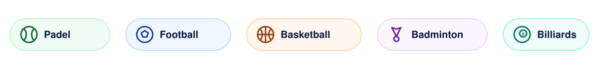
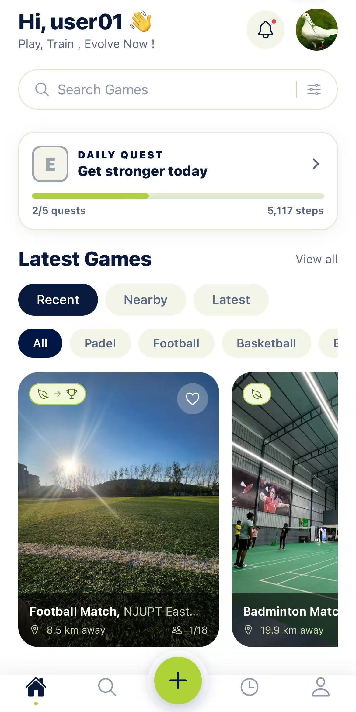
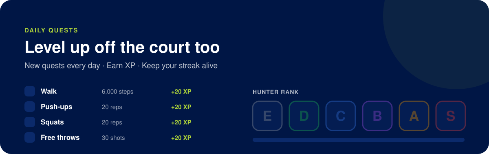

 

**Stop looking for players. Start playing.**

PickupPlay finds pickup games on campus and matches you with players at your level.

 

 

## ⚡ What you can do

<table>
<tr>
<td width="55%" valign="top">

### 🔎 Find a game in seconds
Browse games near you by sport and level, see how many spots are left, the court, the time  and even the expected weather.

### ➕ Host your own
Pick the court, date, skill range and number of players. For billiards, choose 8-Ball, 9-Ball, 10-Ball or Snooker.

### 💬 Talk to your group
Every game has its own chat  sort out who's bringing the ball or running late.

### ⚖️ Fair games, every time
A quick evaluation sets your level. After games, teammates confirm it , so every match stays balanced.

</td>
<td width="45%" align="center" valign="top">

</td>
</tr>
</table>

 

 

## 🏆 Daily Quests

Train between games. Every day brings new challenges, steps, push-ups, squats and a drill for your sport. Earn XP, keep your streak alive and climb the ranks from **E** to **S**.

 

## 🎨 Your app, your look

Choose the theme that suits you from your profile:

| ☀️ Light | 🌙 Dark | ⚡ PickUp |
|:---:|:---:|:---:|
| Clean white & navy | Easy on the eyes at night | Navy with lime accents |

 

## 📍 Where can I play?

PickupPlay is live on the **NJUPT campus** with football fields, basketball and tennis courts, multi sport grounds and the billiards room.

 

## 📲 Get the app

| Platform | Status |
|---|---|
| 🤖 **Android** | Available as an APK ( Join the Waitlist ) see the project website |
| 🍎 **iOS** | Coming soon |

 

## ❓ FAQ

<b>Is PickupPlay free?</b>

 
Yes, finding, joining and hosting games is completely free.

<b>How is my skill level decided?</b>

 
When you sign up you answer a few quick questions for each sport you play. That gives you a level from Beginner, Intermediate to Competitive. After each game, teammates can confirm whether it was accurate, and your level adjusts over time.

<b>What if a game is full?</b>

 
Join the waitlist. When a player drops out, the first person in line gets the spot automatically.

<b>Is my data safe?</b>

 
Game chats are only visible to players in that game, ratings are anonymous, and your quest progress is private to you. See the privacy page on the project website for details.

 

---

**PickupPlay** is designed and built by [**TheSPX**](https://github.com/TheSPX) & [**RoxaAF**](https://github.com/RoXaAF/RoxaAF)

© 2026 TheSPX. All rights reserved.

